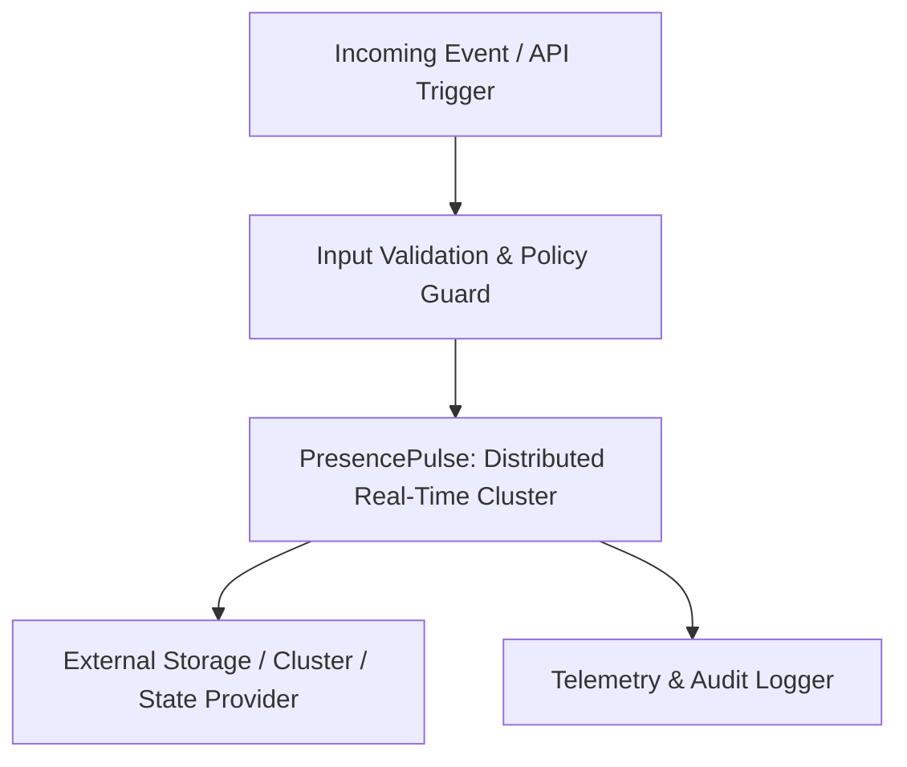

# PresencePulse: Distributed Real-Time Cluster

[](LICENSE)
[](https://github.com/smit-backend/realtime-presence-cluster/stargazers)
[](https://github.com/smit-backend/realtime-presence-cluster/issues)
[](https://php.net)

> **High-throughput presence tracking and broadcast engine maintaining active user heartbeats, channels, and connection states.**

---

## 🚀 Key Architectural Highlights

- **Production Resilience:** Engineered with decoupled interfaces, structured exception trees, and strict typings.
- **High Concurrency Ready:** Built to eliminate latency bottlenecks, memory spikes, and race conditions.
- **Enterprise Standards:** Zero-dependency core logic with clean service provider adapters.
- **Full Observability:** Embedded metrics telemetry and structured contextual logging.

---

## 🛠️ Architecture & Lifecycle Workflow



---

## 📦 Installation & Setup

### Requirements
- **PHP:** `^8.2` or later
- **Composer:** Modern Composer v2+

### Installation via Composer
```bash
composer require smit-backend/realtime-presence-cluster
```

---

## ⚙️ Configuration & Quick Start

Publish configuration and default assets:
```bash
php artisan vendor:publish --tag="realtime-presence-cluster-config"
```

Sample configuration excerpt (`config/realtime-presence-cluster.php`):
```php
return [
    'enabled' => env('REALTIME_PRESENCE_CLUSTER_ENABLED', true),
    'timeout' => env('REALTIME_PRESENCE_CLUSTER_TIMEOUT', 30),
    'log_channel' => env('REALTIME_PRESENCE_CLUSTER_LOG', 'stack'),
];
```

---

## 🧪 Testing

Run test suites locally:
```bash
composer test
```

---

## 🛡️ Security & Contributing

If you discover any security-related issues, please open an issue or email directly via GitHub. Contributions via pull requests are always welcome!

---

## 📄 License

This package is open-sourced software licensed under the [MIT License](LICENSE).

Developed and maintained with ❤️ by **[smit-backend](https://github.com/smit-backend)**.
